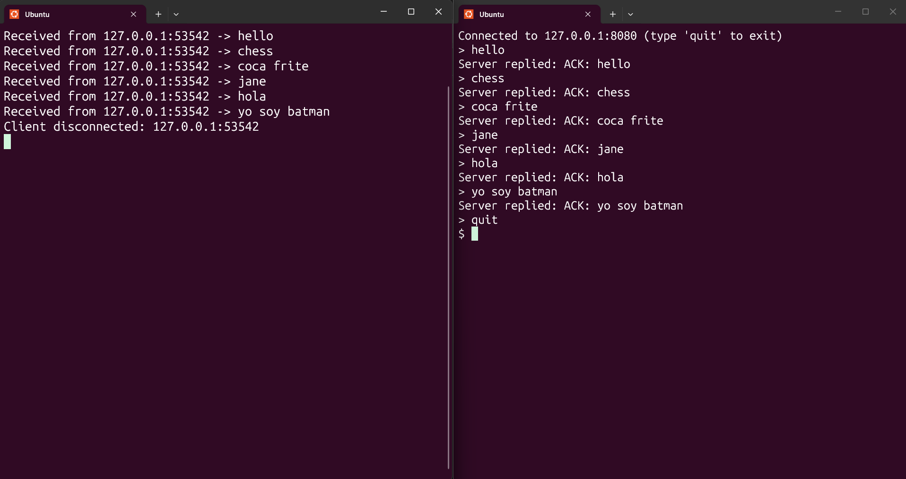

<!-- README.md -->

# tcp-sockets

A minimal TCP client and server in C, built on POSIX (Berkeley) sockets.



## Overview

- **Server:** listens on a TCP port, accepts one client at a time, prints each line it receives along with the sender's address, and replies with `ACK: <message>`.
- **Client:** connects to the server, reads lines from the keyboard, sends each one, and prints the reply.

TCP is connection-oriented and stream-based. The client calls `connect()`, the server calls `listen()` and `accept()`, and both sides know when the other disconnects. TCP has no message boundaries, so this project ends each message with a newline (`\n`) and both programs reassemble lines from the byte stream.

## Requirements

- Linux, macOS, or Windows with WSL
- `gcc` and `make`
- Optional, for testing: `netcat` and Wireshark or `tcpdump`

On Debian/Ubuntu:

```bash
sudo apt update && sudo apt install -y build-essential netcat-openbsd
```

## Build

```bash
git clone https://github.com/ihcnabd/tcp-sockets.git
cd tcp-sockets
make
```

This produces the `server` and `client` binaries. Run `make clean` to remove them.

## Usage

### Server

```bash
./server [port]
```

| Argument | Default | Description                     |
| -------- | ------- | ------------------------------- |
| `port`   | `8080`  | TCP port to listen on (1-65535) |

The server binds to all network interfaces and runs until you stop it with `Ctrl+C`.

### Client

```bash
./client [server_ip] [port]
```

| Argument    | Default     | Description                                                               |
| ----------- | ----------- | ------------------------------------------------------------------------- |
| `server_ip` | `127.0.0.1` | IPv4 address of the server (dotted notation, hostnames are not supported) |
| `port`      | `8080`      | Server TCP port                                                           |

Type a message and press Enter to send it. Type `quit` (or press `Ctrl+D`) to exit. Empty lines are ignored.

### Example

Terminal 1:

```
$ ./server 8080
TCP server listening on port 8080
Client connected: 127.0.0.1:51426
Received from 127.0.0.1:51426 -> hello
Received from 127.0.0.1:51426 -> how are you
Client disconnected: 127.0.0.1:51426
```

Terminal 2:

```
$ ./client 127.0.0.1 8080
Connected to 127.0.0.1:8080 (type 'quit' to exit)
> hello
Server replied: ACK: hello
> how are you
Server replied: ACK: how are you
> quit
```

### Running on two machines

1. On the server machine, find its IP address (`ip addr`) and start `./server 8080`.
2. Allow TCP port 8080 through the firewall.
3. On the other machine, run `./client <server_ip> 8080`.

## Testing without the client

Connect with netcat:

```bash
nc 127.0.0.1 8080
```

Type a line and press Enter. Expected reply: `ACK: <your line>`

## Inspecting the traffic

To see the connection on the wire, capture the loopback interface with `tcpdump`:

```bash
sudo tcpdump -i lo -A tcp port 8080
```

Or use the Wireshark display filter:

```
tcp.port == 8080
```

You will see the three-way handshake (SYN, SYN-ACK, ACK), then one packet per message with its `ACK:` reply, then the connection teardown (FIN). The payload is plain text.

## Protocol

| Property        | Value                                           |
| --------------- | ----------------------------------------------- |
| Transport       | TCP over IPv4                                   |
| Request         | One line of text ending with `\n`               |
| Reply           | One line `ACK: <message>` ending with `\n`      |
| Max line length | About 1000 bytes (server discards longer lines) |
| Clients         | One at a time                                   |

## Project structure

```
tcp-sockets/
├── src/
│   ├── server.c
│   └── client.c
├── docs/
│   └── demo.png
├── Makefile
├── LICENSE
└── README.md
```

## Troubleshooting

| Problem                         | Cause and fix                                                                             |
| ------------------------------- | ----------------------------------------------------------------------------------------- |
| `connect: Connection refused`   | No server is listening on that IP and port. Start the server first, or check the address. |
| `bind: Address already in use`  | Another process uses the port. Pick another port or stop the other process.               |
| `bind: Permission denied`       | Ports below 1024 need root. Use a port of 1024 or higher.                                 |
| `Invalid IP address`            | The client accepts only IPv4 addresses such as `192.168.1.10`, not hostnames.             |
| `connect: Connection timed out` | A firewall blocks the port, or the server machine is unreachable.                         |
| `nc: command not found`         | Install netcat, or on Windows run the command inside WSL.                                 |

## Limitations

This is a simple educational implementation. As written it has:

- **No encryption:** messages are sent in clear text (TLS would be needed).
- **No authentication:** the server accepts any client.
- **No concurrency:** a second client waits until the first one disconnects.
- **IPv4 only.**

## License

MIT, see [LICENSE](LICENSE).

## Author

Houcine Abdaoui, [github.com/ihcnabd](https://github.com/ihcnabd)
